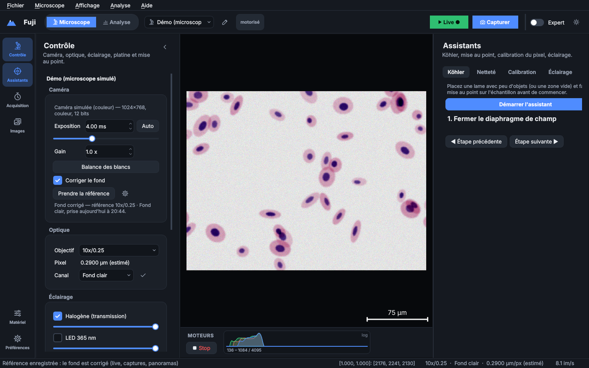
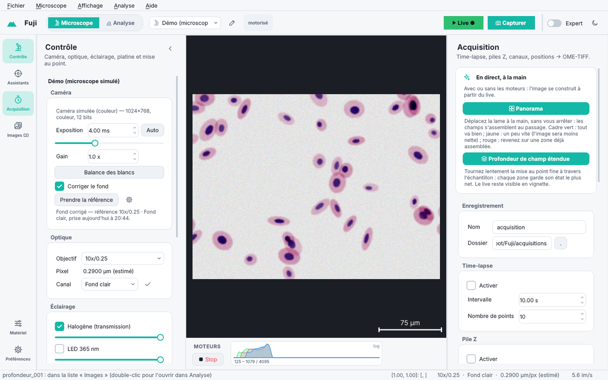

# Fuji

Logiciel de microscopie qui réunit le meilleur de **Micro-Manager** (piloter le
matériel), **napari** (afficher les images) et **Fiji/ImageJ** (analyser), dans une
interface propre qui s'adapte au microscope.

> Projet en développement (version 0.5, validée sur du matériel simulé). Voir
> [docs/ARCHITECTURE.md](docs/ARCHITECTURE.md) et [docs/FEUILLE_DE_ROUTE.md](docs/FEUILLE_DE_ROUTE.md).



## L'interface

- **Barre de navigation** à gauche : Contrôle, Assistants, Acquisition, Analyse,
  Calques, Microscope (configuration), Réglages. Recliquer sur la section active
  replie le panneau pour agrandir l'image.
- **Barre rapide** sous l'image : exposition (curseur logarithmique + auto),
  gain, objectif et canal en un clic, **histogramme en direct** avec alerte de
  saturation.
- **Barre supérieure** : choix du microscope (changement à chaud), Live, Capture,
  mode expert, thème clair / sombre.
- **Thèmes** : sombre ou clair, 7 couleurs d'accent, 3 tailles de texte
  (Réglages → Apparence). Raccourcis : Ctrl+L live, Ctrl+K capture, Ctrl+1…7
  sections, Ctrl+B replier le panneau, Ctrl+E modifier le microscope.



## Configurer un microscope

Section **Microscope** → « Modifier la configuration… » ou « Nouveau microscope… »
(modèles : microscope manuel + ToupTek, manuel avec fluorescence, Micro-Manager,
simulé, vide, copie de l'actuel). L'éditeur couvre **tout** le profil :

| Page | Contenu |
|---|---|
| Général | nom, description, adaptateur caméra, ON du condenseur, dossier, canal au démarrage |
| Statif et optique | fabricant, modèle, droit/inversé, longueur de tube, oculaires, indice de champ, condenseur ; champ, résolution et profondeur de champ calculés par objectif |
| Périphériques | ajout par catégorie (caméras, platines, tourelles, éclairage, systèmes Micro-Manager, simulation), réglages de chaque pilote générés automatiquement, détection des caméras ToupTek |
| Rôles | caméra, platine XY, mise au point, revolver, lampe de transmission |
| Objectifs | grossissement, ON, immersion, contraste, correction, anneau de phase, distance de travail, pixel calibré, parfocalité (+ modèles courants) |
| Cubes de fluorescence | excitation, dichroïque, émission (+ modèles, dont les blocs Leitz Ploemopak A, I3, N2.1) ; un clic crée la tourelle de cubes, la lampe et un canal par cube |
| Canaux | type, cube, exposition, gain, couleur, longueurs d'onde, position de chaque tourelle, état de chaque lampe, obturateurs, préréglage Micro-Manager |
| Fichier YAML | le profil complet, modifiable directement |

« Vérifier » signale les incohérences (rôle mal attribué, position inexistante...),
« Tester la connexion » connecte le matériel et fait une capture d'essai.


## Ce que Fuji sait déjà faire

- **Piloter un microscope manuel** (Leitz Diaplan) comme un microscope motorisé :
  objectifs, lampe et mise au point sont déclarés ; quand un protocole a besoin d'un
  changement, Fuji affiche une consigne (« Placez l'objectif 40x ») et attend.
- **Caméras ToupTek** via le SDK officiel (live, capture par déclenchement logiciel,
  12 bits, balance des blancs, réglages du capteur).
- **Tous les microscopes Micro-Manager** (~250 périphériques) avec une seule ligne de
  profil.
- **Microscope simulé** complet pour tout tester sans matériel (y compris un
  diaphragme de champ et un condenseur mal réglés, pour s'entraîner au Köhler).
- **Assistants** : alignement de Köhler guidé, aide à la mise au point, calibration
  automatique de la taille du pixel avec un micromètre objet, uniformité de
  l'éclairage, correction de champ plat.
- **L'essentiel d'ImageJ, intégré** : 76 opérations recodées avec les formules d'ImageJ —
  types d'image, filtres, soustraction de fond, calculs entre images, les 17 seuillages
  automatiques et les seuillages locaux, binaire, piles (projection, montage, recalage),
  ROI (rectangle, ellipse, polygone, ligne), mesures, profils, histogrammes, maxima,
  analyse de particules, colocalisation, déconvolution des colorants (H&E, DAB...).
  Aperçu en direct, traitement de toute une pile, résultats en µm. Voir
  [la correspondance avec ImageJ](docs/IMAGEJ.md).
- **Fiji lui-même** reste accessible à travers PyImageJ pour le reste (macros, plugins).
- **Acquisition multidimensionnelle** (temps, Z, canaux, positions) décrite avec
  `useq-schema`, enregistrée en **OME-TIFF** avec toutes les métadonnées (lisible
  directement par Fiji/Bio-Formats).
- **Motorisation** : platines du commerce via Micro-Manager, ou motorisation maison avec
  des moteurs pas à pas et une carte Arduino / ESP32 (GRBL, FluidNC) ou d'imprimante 3D
  (Marlin). Arrêt d'urgence, limites de course, rattrapage du jeu, centrage par
  double-clic, **mosaïques assemblées**, autofocus à chaque position. Voir
  [docs/MOTORISATION.md](docs/MOTORISATION.md).
- **Pilotage par une IA** : un serveur MCP intégré laisse un assistant (Claude ou autre)
  voir les images, régler le microscope, lancer acquisitions et analyses, avec des
  garde-fous. Voir [docs/IA.md](docs/IA.md).

## Installation

### Sur Mac : l'application

Un fichier `.dmg` à ouvrir, une icône à glisser dans Applications : rien d'autre à
installer. Voir [docs/INSTALLATION_MAC.md](docs/INSTALLATION_MAC.md) (choix du fichier,
premier lancement, caméra ToupTek).

### Avec Python (macOS, Linux, Windows)

Python 3.10 ou plus récent.

```bash
git clone https://github.com/DrQuercus/Fuji.git
```

```bash
cd Fuji
```

```bash
python3 -m venv .venv && source .venv/bin/activate
```

```bash
pip install -e ".[all]"
```

Options : `gui` (interface), `micromanager` (compatibilité Micro-Manager), `imagej`
(pont Fiji), `moteurs` (motorisation maison), `ia` (pilotage par une IA), `all` (tout),
`dev` (tout + outils de test).

### Caméra ToupTek

Le SDK ToupTek n'est pas inclus (licence du fabricant). Télécharge « ToupTek SDK »
(toupcamsdk.zip) sur le site de ToupTek, puis :

```bash
fuji touptek install ~/Downloads/toupcamsdk.zip
```

```bash
fuji touptek info
```

Détails et dépannage : [docs/TOUPTEK.md](docs/TOUPTEK.md).

### Fiji / ImageJ

Le pont Fiji a besoin de Java. Le plus simple est d'utiliser ton Fiji existant :

```bash
export FUJI_FIJI_PATH=/Applications/Fiji.app
```

Sans cette variable, PyImageJ télécharge ImageJ2 automatiquement au premier usage.

## Utilisation

Interface graphique avec le microscope simulé :

```bash
fuji
```

Avec ton microscope :

```bash
fuji --profile leitz-diaplan-touptek
```

Autres commandes :

```bash
fuji profiles
```

```bash
fuji check
```

```bash
fuji selftest
```

```bash
fuji -p demo snap -o capture.ome.tif
```

```bash
fuji moteurs ports
```

```bash
fuji -p demo mcp
```

(`fuji selftest` ouvre Fuji quelques secondes sur le microscope simulé et vérifie que tout
fonctionne sur cet ordinateur ; `fuji moteurs ports` liste les ports série où chercher une
carte de moteurs ; `fuji mcp` démarre le serveur pour IA, lancé d'ordinaire par l'assistant
lui-même.)

Sans interface (script Python) :

```python
from fuji.core import Microscope
from fuji.analysis import Image, run

with Microscope.from_file("demo") as scope:
    frame = scope.snap()                       # image + métadonnées
image = Image.from_frame(frame)                # calibrée en µm
gray = run("Niveaux de gris", image)
mask = run("Seuillage automatique", gray, method="Otsu", objects="sombres")
table, objets = run("Analyse de particules", mask, intensity=gray, min_area_um2=20)
print(table.summary)                          # nombre, surface totale, %Area...
table.to_csv("particules.csv")
```

## Profils de microscopes

Un profil YAML décrit un setup : périphériques et pilotes, objectifs (grossissement,
ouverture numérique, calibration), canaux (fond clair, DAPI, GFP...). Profils fournis
(`fuji profiles`) :

| Profil | Description |
|---|---|
| `demo` | Microscope simulé motorisé, fond clair + fluorescence |
| `motorise-simulation` | Motorisation maison simulée : platine, mise au point et LED sur un faux contrôleur GRBL |
| `leitz-diaplan-touptek` | Leitz Diaplan manuel + ToupTek E3ISPM08300KPD |
| `micromanager-exemple` | N'importe quelle configuration Micro-Manager |

Les calibrations sont enregistrées dans `~/.fuji/profiles/` sans jamais modifier les
profils fournis.

## État de validation

Le code a été entièrement relu et chaque défaut corrigé est couvert par un test
(environ 230 tests). Tout cela tourne sur du **matériel simulé** : la vraie caméra ToupTek,
macOS, de vrais moteurs, une vraie conversation avec une IA et la comparaison directe avec
ImageJ restent à valider — voir [la feuille de route](docs/FEUILLE_DE_ROUTE.md).

Les fonctions d'ImageJ recodées sont vérifiées contre les formules d'ImageJ, pas encore
contre ImageJ lui-même : le test `tests/test_imagej_parity.py` fait cette comparaison sur
ton ordinateur (environ 90 cas).

## Tests

```bash
pip install -e ".[dev]"
```

```bash
pytest
```

Sous Linux sans écran : `xvfb-run -a pytest`. Comparaison directe avec ImageJ :
`FUJI_TEST_IMAGEJ=1 pytest tests/test_imagej_parity.py`.

## Licence

Fuji est un logiciel libre sous licence [BSD-3-Clause](LICENSE), comme napari,
pymmcore-plus et scikit-image sur lesquels il s'appuie.

Les composants externes gardent leur propre licence : Micro-Manager, Fiji/ImageJ
(installés séparément) et le SDK ToupTek, propriétaire, que Fuji n'inclut pas et
que chacun télécharge chez le fabricant.

## Contribuer

Les contributions sont bienvenues : nouveaux pilotes de matériel, opérations
d'analyse, profils de microscopes, traductions. Voir
[docs/ARCHITECTURE.md](docs/ARCHITECTURE.md) pour ajouter un pilote ou une
opération, et lancer `pytest` avant de proposer une modification.
