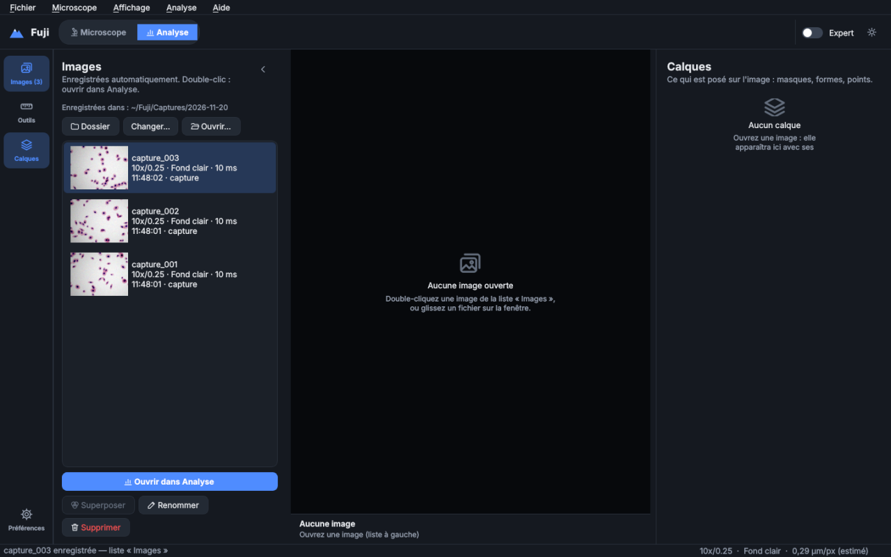
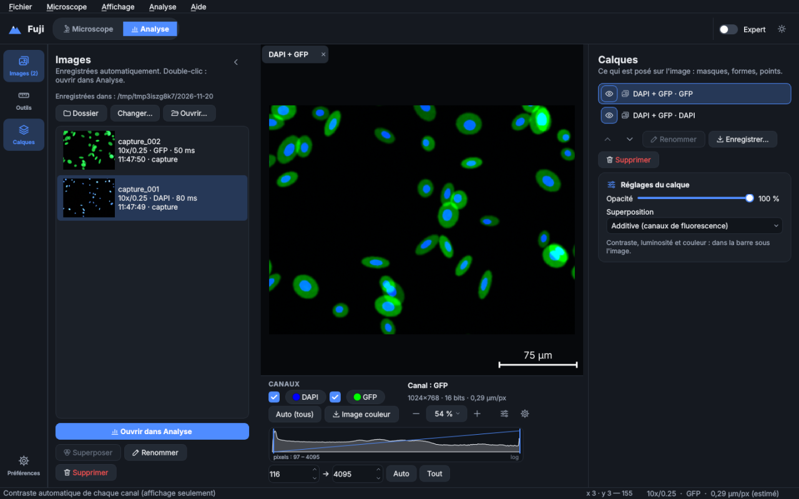
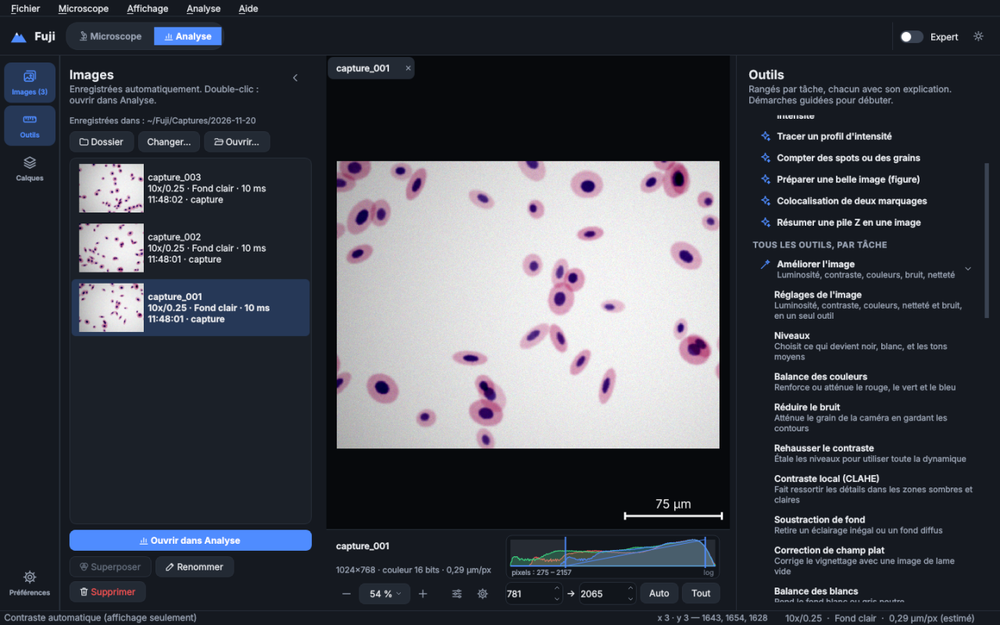
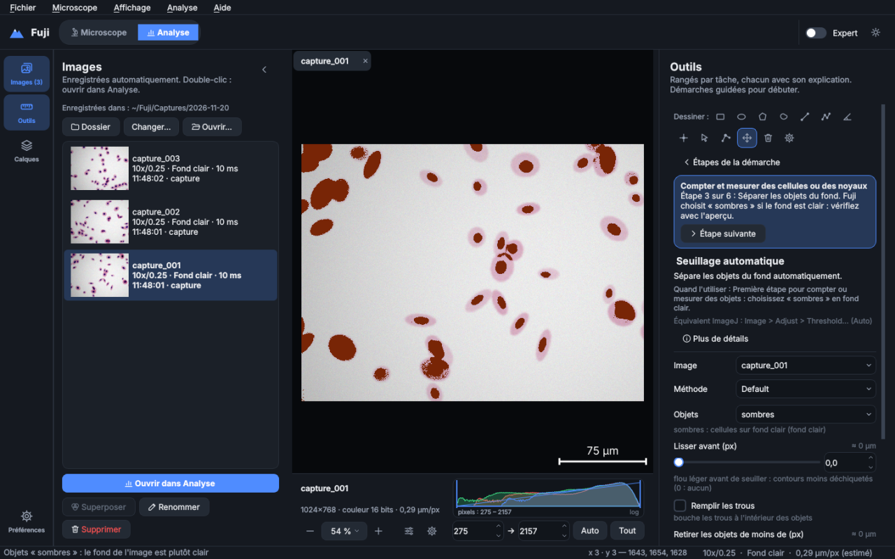
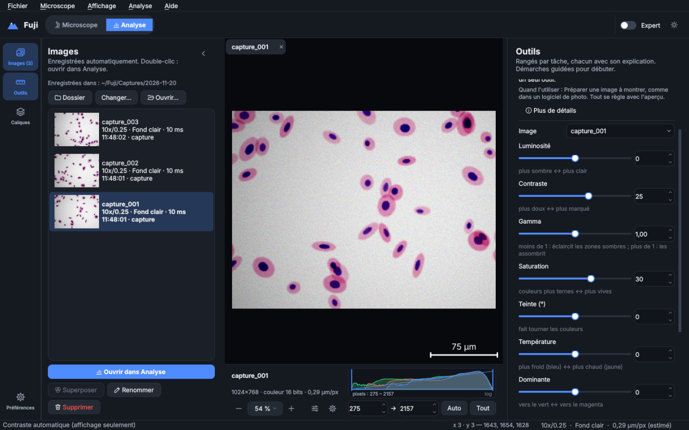
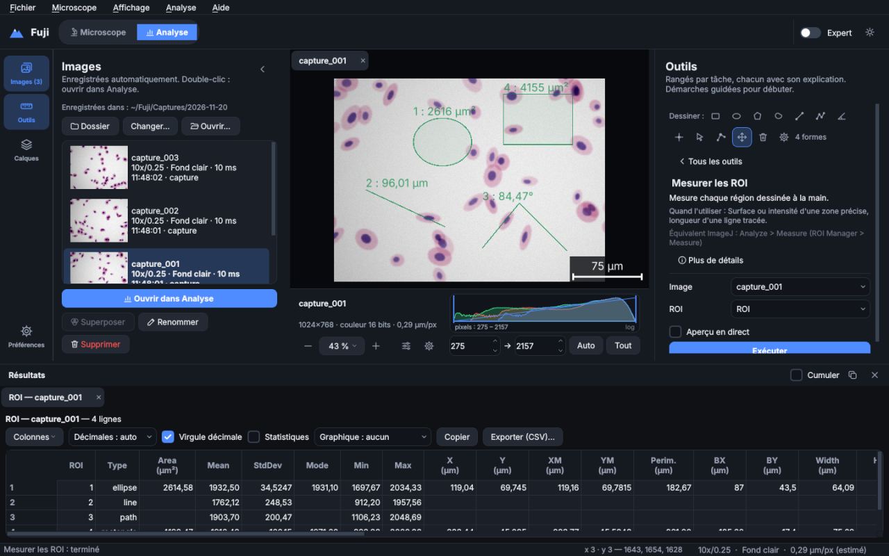
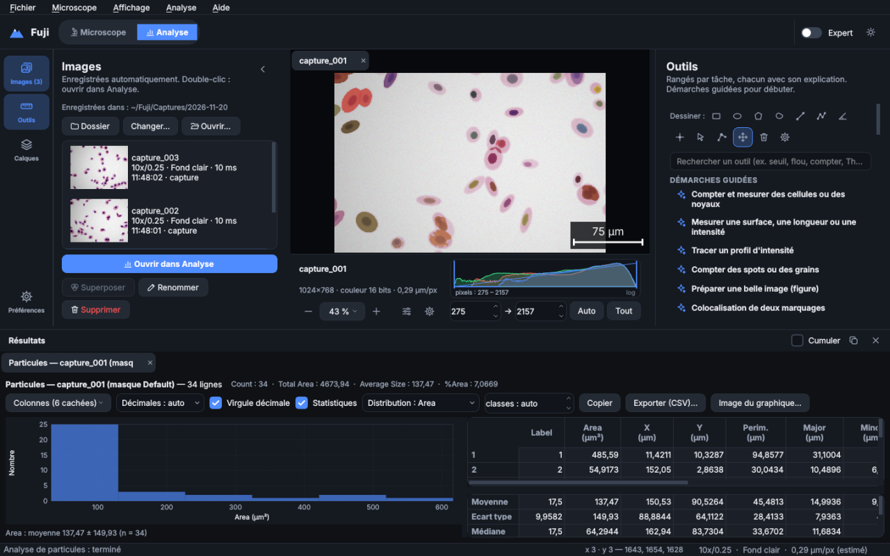
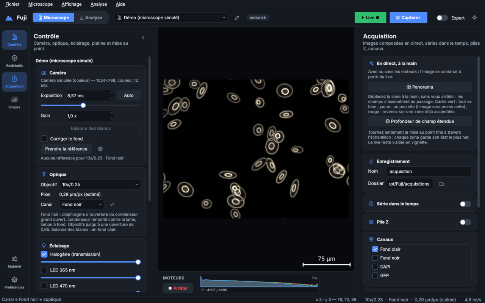
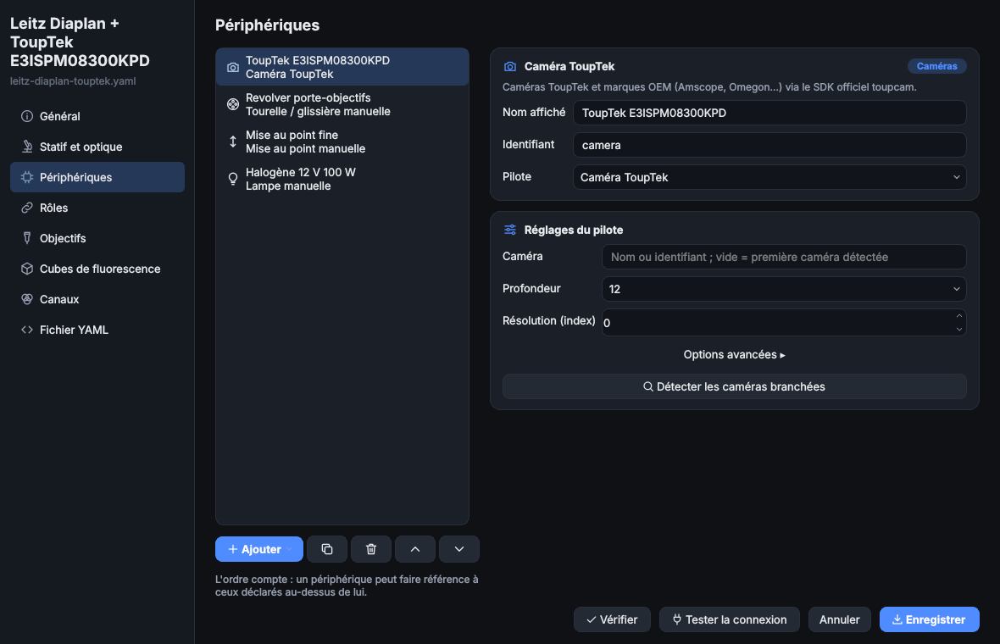

# Fuji

Logiciel de microscopie qui réunit le meilleur de **Micro-Manager** (piloter le
matériel), **napari** (afficher les images) et **Fiji/ImageJ** (analyser), dans une
interface propre qui s'adapte au microscope.

> Projet en développement (version 1.2). Voir
> [docs/ARCHITECTURE.md](docs/ARCHITECTURE.md) et [docs/FEUILLE_DE_ROUTE.md](docs/FEUILLE_DE_ROUTE.md).


## L'interface

Deux **espaces de travail**, choisis en haut de la fenêtre, chacun avec sa propre vue
d'image pour ne pas mélanger prise de vue et analyse :

- **Microscope** : le panneau **Contrôle** (caméra, objectif, éclairage, platine, mise
  au point) reste ouvert à gauche de l'image pendant qu'on se sert, à droite, des
  Assistants, de l'Acquisition, de la liste des Images ou de la configuration. Sous
  l'image, l'**histogramme en direct** (alerte de saturation).
- **Analyse** : la liste des **Images** reste ouverte à gauche ; sous l'image, la
  **barre d'affichage** (zoom, histogramme, contraste, luminosité, gamma, couleur) ; à
  droite, les **outils** et les calques ; en bas, les résultats. Le live s'y met en pause
  et reprend au retour.

Chaque panneau se replie : bouton de sa section dans la barre de gauche (Contrôle,
Images), ou Ctrl+Shift+B à gauche et Ctrl+B à droite. Contrôle replié, la barre sous
l'image reprend exposition, gain, objectif et canal.

Chaque capture (bouton **Capturer**, Ctrl+K) est **enregistrée automatiquement** dans
`~/Fuji/Captures/<date>` et rejoint la liste **Images**, commune aux deux espaces : un
double-clic l'ouvre dans Analyse. On peut y renommer ou supprimer les images, et revenir
aux images **des jours précédents** (liste des jours au-dessus).

Dans Analyse, chaque image ouverte a son **onglet**, au-dessus de l'image : ouvrir une image
ne ferme pas les autres (leur nom est en gras dans la liste), un clic sur un onglet passe
de l'une à l'autre — chacune garde ses résultats, ses masques et ses réglages —, la croix
de l'onglet (ou Ctrl+W) la ferme. Rouvrir une image déjà ouverte remontre son onglet.

**Superposer des canaux** (DAPI, GFP, fond clair…) : dans la liste, choisissez une image
par canal (⌘ ou Ctrl + clic), puis **Superposer**. Chaque canal prend sa couleur (celle de
la configuration, ou d'après le nom du fluorochrome) ; une capture couleur de
fluorescence est ramenée à la couleur de la caméra qui porte le signal, un fond clair reste
en couleur, en dessous. Sous l'image, une pastille par canal : la case le montre ou le
cache, un clic le choisit pour régler son contraste, un clic droit change sa couleur.
**Image couleur** en fait une image telle qu'on la voit, pour une figure. Une acquisition
à plusieurs canaux s'ouvre directement superposée.





La fenêtre tient sur un portable : environ 1050 pixels de large au minimum avec les deux
panneaux, 750 en repliant celui de gauche (la barre du haut se compacte, la barre sous
l'image passe à la ligne). Thèmes sombre ou clair, 7 couleurs
d'accent, 3 tailles de texte. Raccourcis : Ctrl+1 Microscope, Ctrl+2 Analyse, Ctrl+3
Images, Ctrl+L live, Ctrl+K capture, Ctrl+B replier le panneau.

## Analyser sans être spécialiste

Les outils sont rangés **par ce que l'on veut faire** — améliorer l'image, isoler les
objets, retoucher un masque, compter et mesurer, intensités et profils, couleurs et
canaux… — avec **une ligne d'explication sous chaque outil**. Un clic ouvre sa **fiche** :
ce qu'il fait, quand l'utiliser, son équivalent ImageJ, puis ses réglages, l'aperçu en
direct et « Exécuter ». Les mêmes menus sont dans la barre de menus « Analyse ».



Pour débuter, les **démarches guidées** enchaînent les bons outils, étape par étape :
compter et mesurer des cellules, mesurer une surface ou une longueur, tracer un profil,
compter des spots, préparer une figure, colocalisation, projection d'une pile Z.



### Des réglages partout

Chaque fiche d'outil a de **vrais réglages** : un curseur et un champ pour chaque nombre,
une ligne qui dit ce que fait le réglage, l'équivalent en µm des tailles en pixels, les
réglages avancés repliés dans la fiche, « Valeurs par défaut », et les derniers réglages
utilisés retenus pour la fois suivante. L'**aperçu en direct** se compare à l'original
(bouton « Voir l'original », opacité de l'aperçu).



Quatre outils de retouche, comme dans un logiciel de photo : **Réglages de l'image**
(luminosité, contraste, gamma, saturation, teinte, température, netteté, bruit),
**Niveaux**, **Balance des couleurs** et **Réduire le bruit**. Les seuillages nettoient le
masque dans la foulée (lisser avant, remplir les trous, retirer les petits objets) ; le
profil et l'histogramme se tracent par canal (rouge, vert, bleu, ou les trois courbes).

La **barre d'affichage**, toujours sous l'image, règle ce que l'on voit sans toucher aux
pixels : **zoom** (−, +, 100 %, ajuster), histogramme du plan affiché (on tire les bornes à
la souris), min / max, **Auto**, **Tout** ; et, dépliables, **luminosité**, **contraste**,
gamma, couleur (et son négatif), transparence des **masques**. La roue dentée ouvre les
options : part de pixels saturés d'« Auto », lissage de l'image agrandie, **barre
d'échelle** (position, couleur, taille, longueur) et « appliquer le contraste aux pixels ».
Les mesures utilisent toujours les vraies valeurs.

Sur l'image, on **dessine** rectangles, ellipses, polygones, contours à main levée, lignes,
trajets, angles et points. Chaque forme porte son **numéro** et sa **mesure** (longueur,
surface, angle), mise à jour pendant qu'on la dessine ; couleur, épaisseur, remplissage et
taille du texte se règlent (roue dentée de la rangée « Dessiner »). Le trait garde son
épaisseur à l'écran, même sur une image 4K vue en entier.



Le panneau **Calques** liste ce qui est posé sur l'image (masques, formes, points, aperçus) :
un œil pour cacher ou montrer, monter, descendre, renommer, enregistrer, supprimer, et pour
le calque choisi son opacité, son mode de fusion ou ses contours. Les réglages complets de
napari (en anglais) n'apparaissent qu'en mode expert.

Le **tableau de résultats** se règle aussi : colonnes à montrer, décimales, virgule décimale
pour Excel en français, tri d'un clic sur un titre, **statistiques** de chaque colonne
(moyenne, écart type, médiane, min, max, somme), **distribution** d'une colonne en
graphique, et « **Cumuler** » pour réunir les mesures d'une série d'images dans un seul
tableau.



## Configurer un microscope

Section **Matériel** → « Modifier la configuration… » ou « Nouveau microscope… »
(modèles : microscope manuel + ToupTek, manuel avec fluorescence, Micro-Manager,
simulé, vide, copie de l'actuel). L'éditeur couvre **tout** le profil :

| Page | Contenu |
|---|---|
| Général | nom, description, adaptateur caméra, ON du condenseur, dossier, canal au démarrage |
| Statif et optique | fabricant, modèle, droit/inversé, longueur de tube, oculaires, indice de champ, condenseur ; champ, résolution et profondeur de champ calculés par objectif |
| Périphériques | ajout par catégorie (caméras, platines, tourelles, éclairage, systèmes Micro-Manager, simulation), réglages de chaque pilote générés automatiquement, détection des caméras ToupTek |
| Rôles | caméra, platine XY, mise au point, revolver, lampe de transmission |
| Objectifs | grossissement, ON, immersion, contraste, correction, anneau de phase, distance de travail, pixel calibré, parfocalité (+ modèles courants) |
| Cubes de fluorescence | excitation, dichroïque, émission (+ modèles, dont les blocs Leitz Ploemopak A, I3, N2.1) ; un clic crée la tourelle de cubes, la lampe et un canal par cube |
| Canaux | type (fond clair, fond noir, fluorescence, réflexion), cube, exposition, gain, couleur, longueurs d'onde, position de chaque tourelle, état de chaque lampe, obturateurs, préréglage Micro-Manager ; « Fond noir » crée en un clic un canal de fond noir prêt à l'emploi |
| Fichier YAML | le profil complet, modifiable directement |

**Fond noir** : un type de canal à part entière. Fuji dit quand tourner le condenseur,
allume la lampe à fond, et prévient si l'objectif en place est trop ouvert pour que le
fond reste noir (au-delà d'une ouverture de 0,65 avec un condenseur à sec, 1,0 à
immersion — valeur réglable). L'exposition automatique vise les objets brillants sans les
saturer ; l'image de référence y retire la lumière parasite (reflets des poussières) au lieu
de diviser par une zone vide, qui est noire ; Köhler et l'analyse de l'éclairage
demandent de repasser en fond clair. Dans le panneau Contrôle, la liste des canaux se
termine par « Ajouter un canal (fond noir…) », qui ouvre directement la bonne page.



« Vérifier » signale les incohérences (rôle mal attribué, position inexistante...),
« Tester la connexion » connecte le matériel et fait une capture d'essai.



## Ce que Fuji sait déjà faire

- **Images composées en direct, à la main** : **profondeur de champ étendue** (on tourne
  la mise au point, l'image nette partout se construit) et **panorama** (on déplace la
  lame, les champs s'assemblent). Aucun moteur nécessaire. Voir
  [docs/EN_DIRECT.md](docs/EN_DIRECT.md).
- **Piloter un microscope manuel** (Leitz Diaplan) comme un microscope motorisé :
  objectifs, lampe et mise au point sont déclarés ; quand un protocole a besoin d'un
  changement, Fuji affiche une consigne (« Mettez en place « 40x/0.65 » ») et attend.
- **Caméras ToupTek** via le SDK officiel (live, capture par déclenchement logiciel,
  12 bits, balance des blancs, réglages du capteur).
- **Tous les microscopes Micro-Manager** (~250 périphériques) avec une seule ligne de
  profil.
- **Microscope simulé** complet pour tout tester sans matériel (y compris un
  diaphragme de champ et un condenseur mal réglés, pour s'entraîner au Köhler).
- **Assistants** : alignement de Köhler guidé, aide à la mise au point, calibration
  automatique de la taille du pixel avec un micromètre objet, uniformité de
  l'éclairage.
- **Image de référence** (champ plat) : sur une zone vide de la lame, « Prendre la
  référence » ; le fond devient uniforme dès le live — coins sombres et poussières
  disparaissent des captures, des panoramas et des acquisitions.
- **L'essentiel d'ImageJ, intégré** : 80 opérations (175 réglages), recodées avec les formules d'ImageJ —
  types d'image, filtres, soustraction de fond, calculs entre images, les 17 seuillages
  automatiques et les seuillages locaux, binaire, piles (projection, montage, recalage),
  ROI (rectangle, ellipse, polygone, main levée, ligne, trajet, angle), mesures, profils, histogrammes, maxima,
  analyse de particules, colocalisation, déconvolution des colorants (H&E, DAB...).
  Aperçu en direct, traitement de toute une pile, résultats en µm. Voir
  [la correspondance avec ImageJ](docs/IMAGEJ.md).
- **Fiji lui-même** reste accessible à travers PyImageJ pour le reste (macros, plugins).
- **Acquisition multidimensionnelle** (temps, Z, canaux, positions) décrite avec
  `useq-schema`, enregistrée en **OME-TIFF** avec toutes les métadonnées (lisible
  directement par Fiji/Bio-Formats).
- **Motorisation** : platines du commerce via Micro-Manager, ou motorisation maison avec
  des moteurs pas à pas et une carte Arduino / ESP32 (GRBL, FluidNC) ou d'imprimante 3D
  (Marlin). Arrêt d'urgence, limites de course, rattrapage du jeu, centrage par
  double-clic, **mosaïques assemblées**, autofocus à chaque position. Voir
  [docs/MOTORISATION.md](docs/MOTORISATION.md).
- **Pilotage par une IA** : un serveur MCP intégré laisse un assistant (Claude ou autre)
  voir les images, régler le microscope, lancer acquisitions et analyses, avec des
  garde-fous. Voir [docs/IA.md](docs/IA.md).

## Installation

### Sur Mac : l'application

Un fichier `.dmg` à ouvrir, une icône à glisser dans Applications : rien d'autre à
installer. Voir [docs/INSTALLATION_MAC.md](docs/INSTALLATION_MAC.md) (choix du fichier,
premier lancement, caméra ToupTek).

### Avec Python (macOS, Linux, Windows)

Python 3.10 ou plus récent.

```bash
git clone https://github.com/DrQuercus/Fuji.git
```

```bash
cd Fuji
```

```bash
python3 -m venv .venv && source .venv/bin/activate
```

```bash
pip install -e ".[all]"
```

Options : `gui` (interface), `micromanager` (compatibilité Micro-Manager), `imagej`
(pont Fiji), `moteurs` (motorisation maison), `ia` (pilotage par une IA), `all` (tout),
`dev` (tout + outils de test).

### Caméra ToupTek

Le SDK ToupTek n'est pas inclus (licence du fabricant). Télécharge « ToupTek SDK »
(toupcamsdk.zip) sur le site de ToupTek, puis :

```bash
fuji touptek install ~/Downloads/toupcamsdk.zip
```

```bash
fuji touptek info
```

Détails et dépannage : [docs/TOUPTEK.md](docs/TOUPTEK.md).

### Fiji / ImageJ

Le pont Fiji a besoin de Java. Le plus simple est d'utiliser ton Fiji existant :

```bash
export FUJI_FIJI_PATH=/Applications/Fiji.app
```

Sans cette variable, PyImageJ télécharge ImageJ2 automatiquement au premier usage.

## Utilisation

Interface graphique avec le microscope simulé :

```bash
fuji
```

Avec ton microscope :

```bash
fuji --profile leitz-diaplan-touptek
```

Autres commandes :

```bash
fuji profiles
```

```bash
fuji check
```

```bash
fuji selftest
```

```bash
fuji -p demo snap -o capture.ome.tif
```

```bash
fuji moteurs ports
```

```bash
fuji -p demo mcp
```

(`fuji selftest` ouvre Fuji quelques secondes sur le microscope simulé et vérifie que tout
fonctionne sur cet ordinateur ; `fuji moteurs ports` liste les ports série où chercher une
carte de moteurs ; `fuji mcp` démarre le serveur pour IA, lancé d'ordinaire par l'assistant
lui-même.)

Sans interface (script Python) :

```python
from fuji.core import Microscope
from fuji.analysis import Image, run

with Microscope.from_file("demo") as scope:
    frame = scope.snap()                       # image + métadonnées
image = Image.from_frame(frame)                # calibrée en µm
gray = run("Niveaux de gris", image)
mask = run("Seuillage automatique", gray, method="Otsu", objects="sombres")
table, objets = run("Analyse de particules", mask, intensity=gray, min_area_um2=20)
print(table.summary)                          # nombre, surface totale, %Area...
table.to_csv("particules.csv")
```

## Profils de microscopes

Un profil YAML décrit un setup : périphériques et pilotes, objectifs (grossissement,
ouverture numérique, calibration), canaux (fond clair, DAPI, GFP...). Profils fournis
(`fuji profiles`) :

| Profil | Description |
|---|---|
| `demo` | Microscope simulé motorisé, fond clair, fond noir et fluorescence |
| `motorise-simulation` | Motorisation maison simulée : platine, mise au point et LED sur un faux contrôleur GRBL |
| `leitz-diaplan-touptek` | Leitz Diaplan manuel + ToupTek E3ISPM08300KPD, fond clair et fond noir |
| `micromanager-exemple` | N'importe quelle configuration Micro-Manager |

Les calibrations sont enregistrées dans `~/.fuji/profiles/` sans jamais modifier les
profils fournis.

## État de validation

Le code a été entièrement relu et chaque défaut corrigé est couvert par un test
(environ 390 tests, lancés à chaque modification sous Linux **et sur macOS**). L'application
Mac est construite puis essayée automatiquement sur des Mac de GitHub (processeurs Apple
et Intel) avant d'être proposée au téléchargement.

Tout cela tourne sur du **matériel simulé**. La vraie caméra ToupTek se connecte et envoie
ses images (essai sur Mac) ; le panorama, la profondeur de champ étendue et l'image de
référence sont réglés sur un banc qui imite une main, pas encore sur le vrai microscope.
De vrais moteurs, une vraie conversation avec une IA et la comparaison directe avec ImageJ
restent à valider — voir [la feuille de route](docs/FEUILLE_DE_ROUTE.md).

Les fonctions d'ImageJ recodées sont vérifiées contre les formules d'ImageJ, pas encore
contre ImageJ lui-même : le test `tests/test_imagej_parity.py` fait cette comparaison sur
ton ordinateur (environ 90 cas).

## Tests

```bash
pip install -e ".[dev]"
```

```bash
pytest
```

Sous Linux sans écran : `xvfb-run -a pytest`. Comparaison directe avec ImageJ :
`FUJI_TEST_IMAGEJ=1 pytest tests/test_imagej_parity.py`.

## Licence

Fuji est un logiciel libre sous licence [BSD-3-Clause](LICENSE), comme napari,
pymmcore-plus et scikit-image sur lesquels il s'appuie.

Les composants externes gardent leur propre licence : Micro-Manager, Fiji/ImageJ
(installés séparément) et le SDK ToupTek, propriétaire, que Fuji n'inclut pas et
que chacun télécharge chez le fabricant.

## Contribuer

Les contributions sont bienvenues : nouveaux pilotes de matériel, opérations
d'analyse, profils de microscopes, traductions. Voir
[docs/ARCHITECTURE.md](docs/ARCHITECTURE.md) pour ajouter un pilote ou une
opération, et lancer `pytest` avant de proposer une modification.
