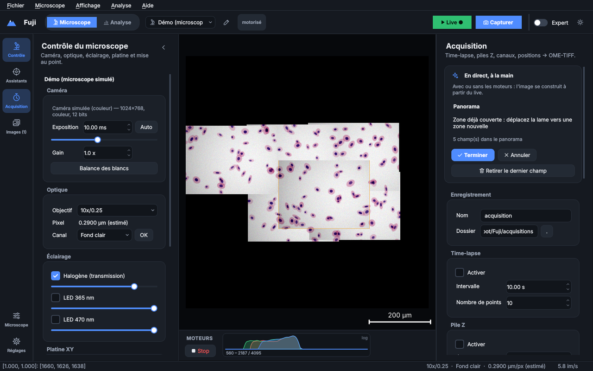
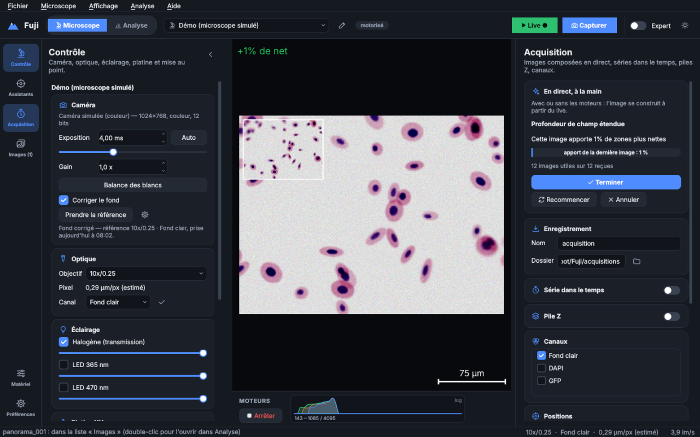

# Images composées en direct, à la main

Trois outils pour un microscope **manuel** (aucun moteur nécessaire), qui fonctionnent comme
ceux du logiciel fourni avec la caméra : tout se voit **dans le live**, pendant que tu
déplaces la lame ou que tu tournes la mise au point.

| Outil | À quoi il sert | Où |
|---|---|---|
| **Image de référence** | fond uniforme : plus de coins sombres ni de poussières | Contrôle → Caméra |
| **Panorama** | une zone plus grande que le champ de la caméra | Acquisition → En direct, à la main |
| **Profondeur de champ étendue** | un objet épais, net partout | Acquisition → En direct, à la main |

Le résultat d'un panorama ou d'une profondeur de champ étendue arrive dans la liste
**Images**, déjà enregistré.

## Image de référence (fond corrigé)

L'éclairage n'est jamais parfaitement uniforme (coins plus sombres), et le capteur ou
l'optique portent toujours quelques poussières. L'**image de référence** est une photo de
tout cela, sans échantillon ; chaque image est ensuite divisée par elle.

1. Place une zone **vide** de la lame sous l'objectif, nette, bien éclairée : l'histogramme
   vers le milieu, rien de saturé.
2. **Contrôle → Caméra → Prendre la référence** (2 secondes : moyenne de 16 images).
3. C'est tout : « Corriger le fond » se coche et le live devient uniforme. Les captures, les
   panoramas, la profondeur de champ étendue et les acquisitions utilisent la même image
   corrigée.

À savoir :

- **Une référence par objectif et par canal.** Elle est gardée d'un jour à l'autre. Si tu
  changes d'objectif dans Fuji et qu'il n'a pas encore de référence, la correction se
  suspend et le panneau le dit (« Pas de référence pour 40x… ») : reprends-en une.
- **Refais-la** si tu modifies l'éclairage (Köhler, diaphragmes, condenseur) ou si une
  nouvelle poussière apparaît. Changer l'exposition ou l'intensité de la lampe ne demande
  pas de la refaire.
- Fuji **refuse** une référence saturée ou trop sombre, et **prévient** s'il voit quelque
  chose dans le champ (un échantillon s'imprimerait en négatif sur toutes les images).
- La balance des blancs ne change pas : chaque couleur garde sa luminosité moyenne.
- Le bouton ⚙ à côté : **Prendre le noir** (lumière coupée ; utile en fluorescence et en pose
  longue) et **Effacer cette référence**.
- Les valeurs mesurées ensuite (intensités) sont celles de l'image corrigée ; la capture le
  note dans ses informations (« fond corrigé »).

## Panorama

Pour une zone plus grande que le champ de la caméra : pousse la lame à la main, **sans
t'arrêter**, les champs s'assemblent au passage.

1. Clique **Panorama**. Le premier champ est posé tout de suite.
2. Déplace la lame, dans n'importe quelle direction : chaque fois qu'un peu de surface
   nouvelle entre dans l'image, un champ est ajouté. Fais des allers-retours qui se
   recouvrent d'un quart de champ environ.
3. **Terminer** assemble le résultat en pleine résolution, raccords fondus.

Le cadre autour du live et le texte en haut de l'image disent où tu en es :

| Cadre | Signification | Que faire |
|---|---|---|
| vert | tout va bien, les champs s'ajoutent | continue |
| jaune « un peu vite » | le champ est posé, mais un peu flou (flou de bougé) | rien, ou repasse plus lentement : l'image nette remplace la floue |
| jaune « trop vite » | rien n'est posé | ralentis |
| gris | zone déjà assemblée | avance vers du nouveau |
| rouge | position perdue (geste brusque, ou zone sans aucun détail) | **reviens sur une zone déjà assemblée** : le suivi reprend tout seul |

La vitesse permise dépend du **temps de pose** : plus il est court, plus tu peux aller vite
sans flou. En fond clair, monte la lampe et baisse l'exposition (quelques millisecondes).

**Retirer le dernier champ** enlève un champ raté. **Recommencer** efface tout et repart.

Pour un beau résultat :

- prends une **image de référence** avant (voir plus haut) : plus de poussières répétées
  d'un champ à l'autre ;
- sans référence, Fuji compense quand même l'éclairage inégal : il l'estime à partir de
  tous les champs (dès le 8ᵉ), ce qui supprime les bandes sombres entre les rangées ;
- désactive l'exposition automatique de la caméra, si elle en a une : la luminosité ne doit
  pas changer en route.

Un très grand panorama est assemblé à une résolution réduite (moitié, tiers…) pour ne pas
dépasser la mémoire de l'ordinateur ; le résumé dans la liste « Images » l'indique.

## Profondeur de champ étendue

Pour un objet plus épais que la profondeur de champ (grains de pollen, coupes épaisses,
insectes, cristaux) : une seule image nette partout.

1. Fais la mise au point **juste au-dessus** de l'objet (tout est flou).
2. Clique **Profondeur de champ étendue**. L'image composée prend toute la vue ; le **live
   reste visible en vignette**, en haut à gauche, pour voir où en est la mise au point.
3. Tourne **lentement** la mise au point fine jusqu'à **dépasser** le bas de l'objet. Chaque
   zone de l'image garde l'état le plus net vu jusque-là.
4. Le texte sur l'image passe de « +12 % de net » à « Plus rien de nouveau ici » quand tu as
   tout traversé : clique **Terminer**.

Conseils :

- Ne touche pas à la platine pendant ce temps. Si la lame bouge, les images sont écartées
  (« La lame a bougé ») ; dès qu'elle revient en place, tout reprend.
- Lent et régulier vaut mieux que rapide : une zone traversée trop vite peut manquer son
  image la plus nette. Repasser dans l'autre sens ne gâche rien.
- Un fond vide ne « scintille » pas : une zone n'est remplacée que si elle contient quelque
  chose de mesurable au-dessus du bruit de la caméra.

## Essayer sans microscope

Avec le microscope de démonstration : dans **Contrôle → Toutes les propriétés** (mode
expert), « Échantillon : vide » donne une zone vide pour l'image de référence, et
« Épaisseur de l'échantillon : 40 µm » simule un objet épais. Pour le panorama, déplace la
platine simulée avec les flèches du panneau Contrôle.

## Ce qui a été vérifié, et ce qui ne l'a pas été

Ces trois outils sont essayés automatiquement sur un banc qui imite une main : lame poussée
sans arrêt avec un léger tremblement, flou de bougé selon la vitesse et le temps de pose,
éclairage inégal, poussières fixes, bruit de la caméra, images 4K. Sur ce banc, le panorama
couvre 99 % du parcours avec une erreur de position de 1 à 2 pixels, et la profondeur de
champ étendue retrouve 99 % des détails.

Ils n'ont **pas** pu être essayés sur un vrai microscope : les réglages (vitesse permise,
seuil de bruit) sont à confirmer sur le Diaplan.
