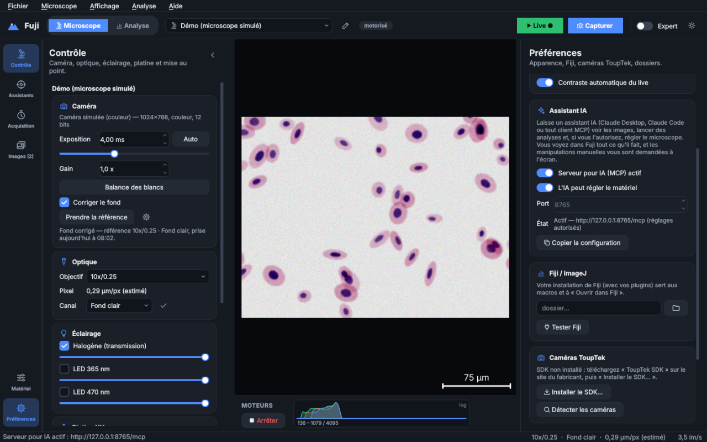

# Piloter Fuji avec une IA

Fuji peut être commandé par un assistant IA externe (Claude, ou tout autre assistant
compatible) : l'IA voit les images, règle la caméra, déplace la platine si elle est
motorisée, lance des acquisitions et fait les analyses — pendant que tu lui parles en
langage courant (« compte les noyaux sur cette lame et donne-moi leur taille moyenne »).

## Comment ça marche

Fuji contient un **serveur MCP** (*Model Context Protocol*) : c'est le standard ouvert
qui permet à une IA d'utiliser des outils extérieurs. Il est compris par Claude Desktop,
Claude Code et la plupart des assistants récents. L'IA ne touche jamais directement au
matériel : elle appelle des **outils** que Fuji lui propose (« prendre une image »,
« déplacer la platine de 50 µm »...), et Fuji vérifie chaque demande avant de l'exécuter.

Fuji n'a pas besoin de clé d'API et n'envoie rien de lui-même sur Internet : c'est
l'assistant IA que tu utilises qui se connecte à Fuji, sur ton ordinateur.

## Installation

```bash
pip install -e ".[ia]"
```

## Deux façons de brancher une IA

### 1. Depuis la fenêtre de Fuji (le plus confortable)

Dans Fuji : **Préférences → Assistant IA → « Serveur pour IA (MCP) actif »**.



L'IA partage alors le microscope de la fenêtre : tu vois dans Fuji tout ce qu'elle fait
(ses images apparaissent comme calques « IA — … », ses tableaux dans Résultats), et sur un
microscope manuel les consignes (« Mettez en place « 40x/0.65 » ») s'affichent à l'écran comme
d'habitude.

L'adresse du serveur est `http://127.0.0.1:8765/mcp` (seulement accessible depuis ton
ordinateur). Le bouton « Copier la configuration » donne le texte à coller dans
l'assistant. Avec Claude Code par exemple :

```bash
claude mcp add --transport http fuji http://127.0.0.1:8765/mcp
```

L'interrupteur « L'IA peut régler le matériel » décide si elle peut agir, ou seulement
regarder et analyser.

### 2. Sans la fenêtre (l'assistant lance Fuji lui-même)

L'assistant démarre Fuji en arrière-plan avec la commande `fuji mcp`. Pour Claude
Desktop, ajoute ceci à son fichier de configuration (menu Réglages → Développeur →
Modifier la configuration), en adaptant le chemin :

```json
{
  "mcpServers": {
    "fuji": {
      "command": "/Users/toi/Fuji/.venv/bin/fuji",
      "args": ["-p", "leitz-diaplan-touptek", "mcp"]
    }
  }
}
```

Avec Claude Code :

```bash
claude mcp add fuji -- /Users/toi/Fuji/.venv/bin/fuji -p leitz-diaplan-touptek mcp
```

Dans ce mode, c'est ce Fuji-là qui tient la caméra : ferme la fenêtre de Fuji avant, la
caméra ne peut servir qu'à un programme à la fois. Les consignes manuelles sont
transmises par l'IA dans la conversation (« place l'objectif 40x, puis dis-moi quand
c'est fait »).

Les menus exacts des assistants changent d'une version à l'autre : en cas de doute,
cherche « ajouter un serveur MCP » dans leur documentation.

### À distance (Raspberry Pi, autre ordinateur)

```bash
fuji -p mon-microscope mcp --http --host 0.0.0.0 --port 8765 --token un-mot-de-passe-long
```

Dès que le serveur écoute ailleurs que sur l'ordinateur lui-même, le mot de passe
(`--token`) est obligatoire : sans lui, n'importe qui sur le réseau pourrait piloter le
microscope. L'assistant doit l'envoyer dans l'en-tête `Authorization: Bearer …`. La
connexion n'est pas chiffrée : à réserver à ton réseau domestique, ou à faire passer par
un tunnel sécurisé (SSH, VPN).

## Les garde-fous

L'IA peut se tromper. Fuji limite donc ce qu'une erreur peut coûter :

| Garde-fou | Par défaut | Option de `fuji mcp` |
|---|---|---|
| Lecture seule (regarder et analyser, ne rien régler) | non | `--read-only` |
| Moteurs autorisés | oui | `--no-motion` |
| Déplacement maximal de platine par commande | 5 000 µm | `--max-xy-step` |
| Déplacement maximal de mise au point par commande | 100 µm | `--max-z-step` |
| Exposition maximale | 5 000 ms | |
| Images par acquisition | 2 000 | |
| Enregistrer une calibration dans le profil | non | `--allow-calibration` |
| Fichiers | uniquement dans `~/Fuji/ia` | `--workspace` |

En plus :

- les limites de course du matériel (profil) s'appliquent toujours ;
- l'**arrêt d'urgence** n'est jamais refusé, même en lecture seule, et passe pendant un
  mouvement en cours ;
- l'IA ne peut pas prétendre qu'une manipulation manuelle est faite : Fuji attend ta
  confirmation ;
- chaque image prise est accompagnée d'un diagnostic (« surexposée », « très sombre »)
  pour que l'IA ne mesure pas n'importe quoi.

Tu restes responsable de ce qui se passe sous l'objectif : pour les premiers essais avec
des moteurs, garde la main près du bouton Stop et règle `z_max_um` dans le profil.

## Ce que l'IA peut faire (37 outils)

| Famille | Outils |
|---|---|
| État et réglages | `microscope_status`, `get_device_properties`, `set_device_property`, `set_exposure`, `auto_exposure`, `set_gain`, `set_objective`, `set_channel`, `set_light` |
| Images | `snap`, `get_image`, `list_items`, `get_table`, `open_image`, `save_item`, `delete_item`, `create_roi`, `create_points` |
| Moteurs | `move_stage`, `center_on_point`, `move_focus`, `autofocus`, `stop_motion`, `home_stage`, `set_origin` |
| Réglage du microscope | `focus_score`, `check_illumination`, `check_field_diaphragm`, `calibrate_pixel_size`, `calibrate_stage`, `measure_backlash` |
| Acquisition | `acquire` (temps, pile Z, canaux, positions, mosaïque, autofocus), `acquisition_status`, `cancel_acquisition` |
| Analyse | `list_operations`, `describe_operation`, `run_operation` : les 76 opérations de la section Analyse (les fonctions essentielles d'ImageJ) |

L'IA reçoit aussi un mode d'emploi (unités, précautions avant de mesurer), l'état du
microscope et son profil, et deux scénarios prêts à l'emploi : « Première image » et
« Compter et mesurer des objets ».

Les images restent sur ton ordinateur ; l'IA n'en reçoit qu'un **aperçu réduit** quand
elle demande à regarder. Les mesures se font toujours sur l'image d'origine, dans Fuji.

## Pour un autre usage (scripts, autre protocole)

Le serveur MCP n'est qu'une fine couche au-dessus d'une classe Python,
`MicroscopeController`, qui porte les garde-fous. Elle s'utilise aussi directement :

```python
from fuji.core import Microscope
from fuji.remote import MicroscopeController, SafetyPolicy

with Microscope.from_file("demo") as scope:
    controle = MicroscopeController(scope, SafetyPolicy(max_z_step_um=20))
    controle.set_channel("Fond clair")
    controle.auto_exposure()
    image = controle.snap()                     # {"nom": "capture_1", "diagnostic": None, ...}
    controle.run_operation("Seuillage automatique", {"image": image["nom"]})
```

## Ce qui reste à vérifier

- Les essais ont été faits avec un client MCP de test, **pas encore avec une vraie
  conversation** dans Claude Desktop ou Claude Code : le serveur respecte le standard,
  mais c'est à l'usage qu'on verra si les descriptions des outils guident bien l'IA.
- Tout a tourné sur le microscope simulé : ni la vraie caméra ToupTek ni de vrais
  moteurs n'ont été pilotés par une IA.
