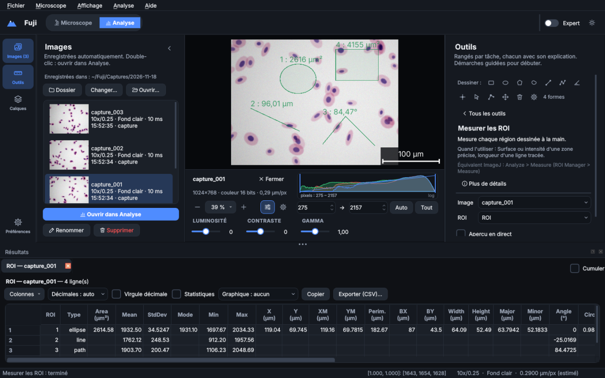

# Fuji et ImageJ

Fuji reprend dans son panneau **Analyse** les fonctions d'ImageJ que l'on utilise tous les
jours, pour ne plus avoir à changer de logiciel dans la majorité des cas. Elles ne passent
pas par Java : elles sont recodées en Python, en suivant les formules d'ImageJ (arrondis,
voisinages, conversions de type, définitions des mesures).



## Les mêmes gestes

| Dans ImageJ | Dans Fuji |
|---|---|
| Menus Process / Analyze / Image | les outils rangés **par tâche** (« Améliorer l'image », « Isoler les objets », « Compter et mesurer »…), dans le panneau **Outils** et dans le menu **Analyse** ; chaque fiche indique la commande ImageJ correspondante |
| Barre d'outils : rectangle, ovale, polygone, main levée, ligne, ligne brisée, angle, points | les mêmes outils, en haut du panneau **Outils** (« Dessiner : ») ; la longueur, la surface ou l'angle s'affiche à côté de la forme pendant qu'on la dessine (dans ImageJ : la barre d'état) |
| ROI Manager (Labels, Properties) | le calque « ROI » : chaque forme est une région numérotée, modifiable et supprimable ; couleur, épaisseur et remplissage dans les réglages du dessin (roue dentée) |
| `M` (Measure) | **Analyse → Mesurer** (`Ctrl+M` ; sur Mac `⌘⇧M`) : les ROI dessinées, sinon l'image entière |
| `H` (Histogram) | **Analyse → Histogramme** (`Ctrl+H` ; sur Mac `⌘⇧H`) |
| `K` (Plot Profile) | **Analyse → Profil d'intensité** (`Ctrl+Maj+K`) sur la ligne tracée |
| Case « Preview » des filtres | case **Aperçu en direct** |
| « Process all slices ? » | case **Toute la pile** |
| Set Scale | **Analyse → Définir l'échelle…** (à partir d'une ligne de longueur connue) |
| Command Finder (`L`) | la recherche du panneau : elle comprend aussi les noms anglais d'ImageJ (« threshold », « z project »…), sans tenir compte des accents |
| Fenêtres d'images, File → Close (`Ctrl+W`) | une image affichée à la fois ; **Fermer** sous l'image (`Ctrl+W`) ; clic droit → « Ouvrir à côté » dans la liste pour en garder plusieurs, à choisir sous l'image |
| Flatten + Scale Bar | **Fichier → Exporter la vue (PNG)** : image, ROI et barre d'échelle |
| Results, Set Measurements, Summarize, Distribution | le volet **Résultats** : tableau trié d'un clic, **Colonnes** au choix, décimales, **Statistiques** par colonne, **Distribution** d'une colonne, export CSV, copie vers Excel (virgule décimale au besoin) ; « **Cumuler** » garde un seul tableau pour une série d'images, comme la fenêtre Results |
| Brightness/Contrast (Auto, Reset, Apply), LUT, Invert LUT | la **barre d'affichage** sous l'image : histogramme et bornes à la souris, min / max, **Auto** (0,35 % saturés, réglable), **Tout**, curseurs luminosité / contraste / gamma, couleur, **Inverser** ; seules les couleurs affichées changent, sauf avec « Appliquer le contraste aux pixels » (roue dentée), qui crée une nouvelle image |
| Zoom (`+`, `-`, View 100 %, Original Scale) | **− / + / 100 % / Ajuster** dans la barre d'affichage ; molette de la souris |
| Analyze → Tools → Scale Bar | roue dentée de la barre d'affichage → **Barre d'échelle** (position, couleur, taille, longueur) |
| Canaux, opacité, mélange | les réglages du calque (section **Calques**) |

Les mesures sont en µm dès que l'image est calibrée (les captures de Fuji le sont toujours).

## Fidélité

Chaque opération est rangée dans l'une de ces trois catégories :

- **identique** : le calcul d'ImageJ est repris tel quel. Le résultat attendu est le même
  au pixel près (ou à la dernière décimale pour les mesures) ;
- **équivalent** : même méthode, mais un détail d'implémentation diffère (interpolation,
  tracé d'une ligne de partage...). Les résultats peuvent s'écarter de quelques pixels ou
  de quelques niveaux de gris ;
- **propre à Fuji** : pas d'équivalent direct dans ImageJ.

> **À vérifier chez toi.** « Identique » veut dire que la formule d'ImageJ a été reprise et
> testée ici contre cette formule — pas contre ImageJ lui-même, qui ne peut pas être
> installé dans l'environnement où Fuji a été écrit. Le test de comparaison directe existe
> et tourne sur ton ordinateur (Java nécessaire, Fiji est téléchargé automatiquement) :
>
> ```bash
> FUJI_TEST_IMAGEJ=1 pytest tests/test_imagej_parity.py
> ```
>
> Il compare environ 90 cas (filtres, seuils, binaire, maxima, mesures de ROI, profils,
> couleurs) et dit précisément lesquels diffèrent.

Cas particuliers connus :

- **Flou gaussien** : identique jusqu'à σ = 4,5 ; au-delà ImageJ réduit l'image pour aller
  plus vite et l'écart peut atteindre un niveau de gris.
- **Détecter les contours** : en 8 bits la valeur est tronquée comme dans ImageJ ; en
  16 bits elle est arrondie (règle à confirmer par le test de comparaison).
- **Seuillages** sur 16 et 32 bits : comme ImageJ, l'image est d'abord ramenée à 256 niveaux.
- **ROI elliptiques** : pixels dont le centre est dans l'ellipse ; ImageJ peut différer d'un
  pixel sur le bord.
- **Niveaux de gris** garde les décimales de (R+V+B)/3 ; pour le gris 8 bits exact d'ImageJ,
  utiliser « Convertir le type ».
- **Trouver les maxima** : positions identiques ; le découpage en zones (« segmenter ») est
  équivalent.
- **Mesures** : mêmes colonnes et mêmes définitions (médiane « haute » des images entières,
  écart-type sur n − 1, périmètre des objets tracés, ellipse ajustée, Feret...).

## Correspondance complète


### Binaire

| Fuji | ImageJ | Fidélité |
|---|---|---|
| Carte des distances | Process > Binary > Distance Map | identique |
| Combiner deux masques | Process > Image Calculator (AND / OR / XOR) | propre à Fuji |
| Contour des objets | Process > Binary > Outline | identique |
| Dilatation | Process > Binary > Dilate | identique |
| Érosion | Process > Binary > Erode | identique |
| Fermeture | Process > Binary > Close- | identique |
| Inverser le masque | Edit > Invert (image binaire) | propre à Fuji |
| Ouverture | Process > Binary > Open | identique |
| Points ultimes | Process > Binary > Ultimate Points | équivalent |
| Remplir les trous | Process > Binary > Fill Holes | identique |
| Retirer les petits objets | — | propre à Fuji |
| Squelette | Process > Binary > Skeletonize | équivalent |
| Voronoï | Process > Binary > Voronoi | équivalent |

### Calcul

| Fuji | ImageJ | Fidélité |
|---|---|---|
| Calculatrice d'images | Process > Image Calculator... | identique |
| Mathématiques | Process > Math > Add / Multiply / Log / Gamma... | identique |

### Contraste

| Fuji | ImageJ | Fidélité |
|---|---|---|
| Contraste local (CLAHE) | Process > Enhance Local Contrast (CLAHE) | équivalent |
| Rehausser le contraste | Process > Enhance Contrast... | identique |

### Conversion

| Fuji | ImageJ | Fidélité |
|---|---|---|
| Convertir le type | Image > Type > 8-bit / 16-bit / 32-bit | identique |
| Inverser | Edit > Invert | identique |
| Niveaux de gris | Image > Type > 8-bit / 32-bit | équivalent |

### Couleur

| Fuji | ImageJ | Fidélité |
|---|---|---|
| Balance des blancs | Image > Adjust > Color Balance... | propre à Fuji |
| Déconvolution des couleurs | Image > Color > Colour Deconvolution | identique |
| Fusionner en RGB | Image > Color > Merge Channels... | identique |
| Séparer en HSB | Image > Type > HSB Stack | identique |
| Séparer en Lab | Image > Type > Lab Stack | équivalent |
| Séparer les canaux | Image > Color > Split Channels | identique |

### Fiji / ImageJ

| Fuji | ImageJ | Fidélité |
|---|---|---|
| Commande ImageJ | — | propre à Fuji |
| Macro ImageJ | Plugins > Macros > Run... | propre à Fuji |

### Filtres

| Fuji | ImageJ | Fidélité |
|---|---|---|
| Accentuer | Process > Sharpen | identique |
| Chapeau haut-de-forme | Process > Filters > Top Hat... | identique |
| Convolution | Process > Filters > Convolve... | identique |
| Débruiter (despeckle) | Process > Noise > Despeckle | identique |
| Détecter les contours | Process > Find Edges | identique |
| Filtre maximum | Process > Filters > Maximum... | identique |
| Filtre médian | Process > Filters > Median... | identique |
| Filtre minimum | Process > Filters > Minimum... | identique |
| Filtre moyenne | Process > Filters > Mean... | identique |
| Filtre passe-bande (FFT) | Process > FFT > Bandpass Filter... | équivalent |
| Filtre variance | Process > Filters > Variance... | identique |
| Flou gaussien | Process > Filters > Gaussian Blur... | identique |
| Lisser | Process > Smooth | identique |
| Masque flou (netteté) | Process > Filters > Unsharp Mask... | identique |
| Retirer les valeurs aberrantes | Process > Noise > Remove Outliers... | identique |

### Fond

| Fuji | ImageJ | Fidélité |
|---|---|---|
| Correction de champ plat | Process > Image Calculator (divide) / BaSiC | propre à Fuji |
| Soustraction de fond | Process > Subtract Background... (rolling ball) | identique |

### Géométrie

| Fuji | ImageJ | Fidélité |
|---|---|---|
| Redimensionner | Image > Scale... / Image > Adjust > Size... | équivalent |
| Regrouper les pixels (bin) | Image > Transform > Bin... | identique |
| Retourner | Image > Transform > Flip Horizontally / Vertically | identique |
| Rogner | Image > Crop | identique |
| Taille du support | Image > Adjust > Canvas Size... | identique |
| Tourner | Image > Transform > Rotate... | équivalent |
| Tourner de 90° | Image > Transform > Rotate 90 Degrees Right / Left | identique |
| Translater | Image > Transform > Translate... | équivalent |

### Mesures

| Fuji | ImageJ | Fidélité |
|---|---|---|
| Analyse de particules | Analyze > Analyze Particles... | identique |
| Colocalisation | Analyze > Colocalization > Coloc 2 | équivalent |
| Compter les points | Plugins > Analyze > Cell Counter / Multi-point Tool | propre à Fuji |
| Histogramme | Analyze > Histogram | identique |
| Mesurer | Analyze > Measure | identique |
| Mesurer les ROI | Analyze > Measure (ROI Manager > Measure) | identique |
| Profil d'intensité | Analyze > Plot Profile | identique |
| Trouver les maxima | Process > Find Maxima... | identique |

### Piles

| Fuji | ImageJ | Fidélité |
|---|---|---|
| Empiler deux images | Image > Stacks > Tools > Concatenate... | identique |
| Inverser l'ordre de la pile | Image > Stacks > Tools > Reverse | identique |
| Montage | Image > Stacks > Make Montage... | équivalent |
| Projection | Image > Stacks > Z Project... | identique |
| Recaler la pile | Plugins > Registration > StackReg (Translation) | équivalent |
| Sous-pile | Image > Stacks > Tools > Make Substack... / Reduce... | identique |

### Réglages

| Fuji | ImageJ | Fidélité |
|---|---|---|
| Balance des couleurs | Image > Adjust > Color Balance... | équivalent |
| Niveaux | Image > Adjust > Brightness/Contrast... (Apply) | équivalent |
| Réduire le bruit | Process > Noise / Filters | propre à Fuji |
| Réglages de l'image | — | propre à Fuji |

### ROI

| Fuji | ImageJ | Fidélité |
|---|---|---|
| Effacer avec les ROI | Edit > Clear / Clear Outside / Fill | propre à Fuji |
| Masque vers ROI | Edit > Selection > Create Selection / Analyze Particles (Add to Manager) | équivalent |
| ROI vers masque | Edit > Selection > Create Mask | identique |

### Segmentation

| Fuji | ImageJ | Fidélité |
|---|---|---|
| Étiqueter les objets | Analyze > Analyze Particles... (Count Masks) | identique |
| Séparer les objets (watershed) | Process > Binary > Watershed | équivalent |
| Seuil manuel | Image > Adjust > Threshold... | identique |
| Seuillage automatique | Image > Adjust > Threshold... (Auto) | identique |
| Seuillage couleur | Image > Adjust > Color Threshold... | équivalent |
| Seuillage local | Image > Adjust > Auto Local Threshold... | identique |

## Ce qui demande encore Fiji

Fuji garde le pont vers Fiji (opérations « Macro ImageJ » et « Commande ImageJ », bouton
« Ouvrir dans Fiji ») pour ce qui n'est pas recodé :

- formats propriétaires (Zeiss .czi, Leica .lif, Nikon .nd2...) : lus par Bio-Formats ;
- suivi d'objets dans le temps (TrackMate), kymographes ;
- assemblage de mosaïques à partir de fichiers déjà enregistrés (Stitching) — les panoramas
  et les mosaïques pris avec Fuji sont assemblés par Fuji ;
- 3D : rendu en volume, comptage d'objets 3D, déconvolution ;
- segmentation par apprentissage (Weka, StarDist, Cellpose) ;
- macros et traitement par lots d'un dossier (prévu dans Fuji : voir la feuille de route) ;
- plugins spécialisés.
