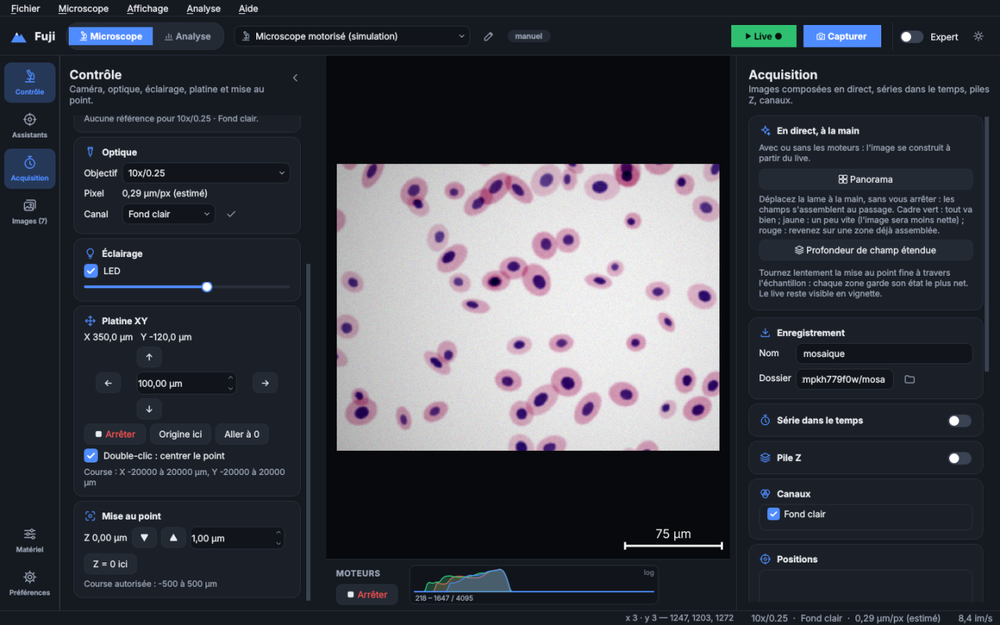
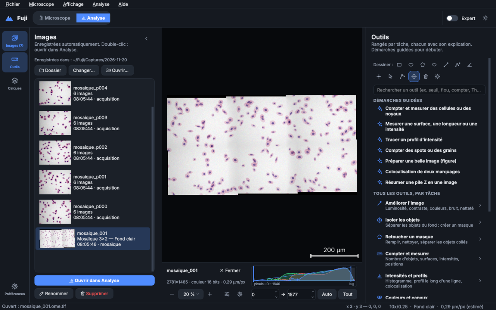

# Motoriser le microscope

Fuji sait piloter une platine XY, une mise au point, une roue à filtres et une LED
motorisées. Tout ce qui suit a été développé et testé sur un **contrôleur simulé** : aucun
vrai moteur n'a encore été branché. La première mise en route sur du vrai matériel
demandera sûrement quelques ajustements (voir « Ce qui reste à vérifier » en bas).

## Deux façons de motoriser

| Matériel | Pilote Fuji | Pour qui |
|---|---|---|
| Platines du commerce (Prior, Märzhäuser, ASI, Zaber, Thorlabs, Ludl...) | `micromanager` | tu as déjà une platine de laboratoire : Micro-Manager sait la piloter, Fuji passe par lui |
| Moteurs pas à pas + carte Arduino / ESP32 / imprimante 3D | `gcode` | motorisation « maison » d'un microscope manuel comme le Leitz Diaplan |

Dans les deux cas le reste de Fuji ne voit pas la différence : mêmes boutons, mêmes
assistants, mêmes acquisitions.

## Essayer sans rien acheter

```bash
fuji --profile motorise-simulation
```

Ce profil fait tourner le vrai pilote `gcode` face à un faux contrôleur GRBL. La caméra
simulée suit la platine et la mise au point : tu peux tout essayer (déplacements, arrêt
d'urgence, calibration, mosaïque, autofocus) avant d'acheter le moindre moteur.

## La motorisation maison (pilote `gcode`)

### Principe

Une petite carte électronique reçoit des ordres simples par USB (« va en X = 1,250 ») et
fait tourner les moteurs. Fuji parle les deux langages les plus répandus :

- **GRBL** (et ses dérivés FluidNC et grblHAL) : cartes Arduino + « CNC shield », cartes
  ESP32. C'est le choix conseillé : arrêt immédiat, lecture de la position en direct.
- **Marlin** : cartes d'imprimantes 3D.

Côté mécanique, il faut un moteur pas à pas par axe : un sur le bouton de mise au point
fine (courroie ou accouplement), deux sur les boutons de la platine, ou une platine
motorisée complète.

### Installation

```bash
pip install -e ".[moteurs]"
```

Branche la carte, puis cherche son port :

```bash
fuji moteurs ports
```

### Le profil

Dans l'éditeur (section Microscope → Périphériques → « Platines et mise au point » →
« Moteurs pas à pas (GRBL, FluidNC, Marlin) »), ou directement dans le fichier YAML :

```yaml
devices:
  - name: moteurs
    driver: gcode
    options:
      port: /dev/cu.usbserial-1420   # donné par « fuji moteurs ports » ; COM3 sous Windows
      firmware: grbl                 # ou marlin
      um_per_unit_xy: 1000           # le contrôleur compte en millimètres réels
      um_per_unit_z: 100             # 1 unité du contrôleur = 100 µm de mise au point
      feed_xy: 600                   # vitesses, en unités par minute
      feed_z: 60
      z_min_um: -500                 # limites : un ordre qui en sort est refusé
      z_max_um: 200
      backlash_z_um: 3               # jeu mécanique, rattrapé automatiquement
      light: broche                  # LED sur la sortie PWM de la carte
```

Cette seule entrée crée plusieurs périphériques : `moteurs_xy` (platine), `moteurs_z`
(mise au point), `moteurs_lampe` (LED), et `moteurs_roue` si tu déclares une roue à
filtres. Ils prennent automatiquement les rôles « platine », « mise au point » et « lampe
de transmission » s'ils sont libres.

Les options principales :

| Option | Rôle |
|---|---|
| `port` | port série ; `simulation` pour le faux contrôleur ; `socket://raspberrypi.local:2217` pour une carte branchée sur un autre ordinateur du réseau |
| `firmware` | `grbl` ou `marlin` |
| `xy_stage`, `focus` | mettre `false` si la carte ne pilote que l'un des deux |
| `um_per_unit_xy`, `um_per_unit_z` | déplacement réel, en µm, pour 1 unité du contrôleur |
| `feed_xy`, `feed_z` | vitesses de déplacement |
| `backlash_xy_um`, `backlash_z_um` | jeu mécanique à rattraper |
| `invert_x`, `invert_y`, `invert_z` | inverser le sens d'un axe |
| `x_min_um` ... `z_max_um` | limites de course (en µm, par rapport à l'origine) |
| `home_on_connect` | prise d'origine sur les fins de course à la connexion |
| `light`, `light_max` | LED : `broche` (GRBL, M3/M5) ou `ventilateur` (Marlin, M106/M107) |
| `wheel_axis`, `wheel_labels`, `wheel_positions` | roue à filtres sur un 4ᵉ axe : nom de l'axe, nom des positions, coordonnée de chaque position |

### Régler `um_per_unit_z`

C'est le réglage le plus important : il dit à Fuji de combien la mise au point bouge
vraiment. Exemple : la carte est réglée pour qu'une « unité » soit un tour de moteur, et
un tour du bouton de mise au point fine déplace la platine de 100 µm → `um_per_unit_z: 100`.

Pour vérifier : demande un déplacement de 50 µm dans Fuji et lis les graduations du bouton.

## Dans l'interface



- **Contrôle** : flèches de déplacement avec pas réglable, position en direct,
  « Origine ici », « Aller à 0 », « Z = 0 ici », et un bouton **■ Arrêter** (aussi dans la
  barre rapide sous l'image) qui arrête immédiatement tous les moteurs.
- **Double-clic sur l'image du live** : le point cliqué vient au centre du champ.
- **Assistants → Platine motorisée** :
  - *Mesurer l'orientation* : la platine fait de petits pas et Fuji regarde dans quel sens
    l'image se déplace. À faire une fois (sur une lame riche en détails), puis
    « Enregistrer dans la configuration ». Nécessaire pour le centrage par double-clic et les
    mosaïques.
  - *Mesurer le jeu* en X et en Y : la valeur trouvée se reporte dans `backlash_xy_um`.
- **Acquisition** :
  - *Mosaïque* : colonnes × rangées avec recouvrement ; les tuiles sont recalées entre
    elles sur l'image, puis assemblées en une seule grande image.
  - *Autofocus* à chaque position (ou à chaque point de temps). Si un champ est vide,
    Fuji garde la mise au point précédente au lieu d'en inventer une.



Sur cette mosaïque, les tuiles sont bien raccordées (les cellules sont continues d'une
tuile à l'autre) mais on devine des bandes plus claires aux raccords : c'est l'éclairage,
jamais parfaitement uniforme dans un champ. Un bon réglage de Köhler les atténue ; leur
correction automatique est prévue. Le décalage en escalier des bords est normal : il
montre que la caméra n'est pas parfaitement alignée avec la platine.

## Sécurités

- Un ordre hors des limites de course est **refusé**, jamais tronqué en silence.
- Le bouton Arrêter reste disponible pendant un mouvement (les moteurs tournent dans un fil
  d'exécution séparé de l'interface).
- Les mesures de l'assistant Platine sont **refusées plutôt que fausses** : image noire,
  lame vide, ou image qui ne suit pas la platine → message clair, rien n'est enregistré.
- Règle toujours `z_max_um` : c'est ce qui empêche l'objectif de toucher la lame.

## En Python

```python
from fuji.core import Microscope
from fuji.core.stage import calibrate_stage, save_stage_calibration, plan_mosaic

with Microscope.from_file("motorise-simulation") as scope:
    scope.apply_channel("Fond clair")
    scope.xy_stage.move_by(100, 0)            # µm
    scope.focus.move_to(12.5)
    save_stage_calibration(scope, calibrate_stage(scope))
    plan = plan_mosaic(scope, columns=3, rows=2, overlap=0.15)
    scope.stop_motion()                       # arrêt d'urgence
```

## Ce qui reste à vérifier

- **Aucun vrai contrôleur n'a été branché.** Le dialogue avec GRBL et Marlin suit leur
  documentation, mais seul un essai réel dira si tout passe du premier coup (délais,
  messages de démarrage, variantes de micrologiciel).
- Les fins de course et la prise d'origine n'ont été essayées qu'en simulation.
- Le rattrapage de jeu et l'assemblage des mosaïques sont validés sur des images
  simulées : sur de vraies lames, le recouvrement et les seuils demanderont peut-être un
  réglage.
